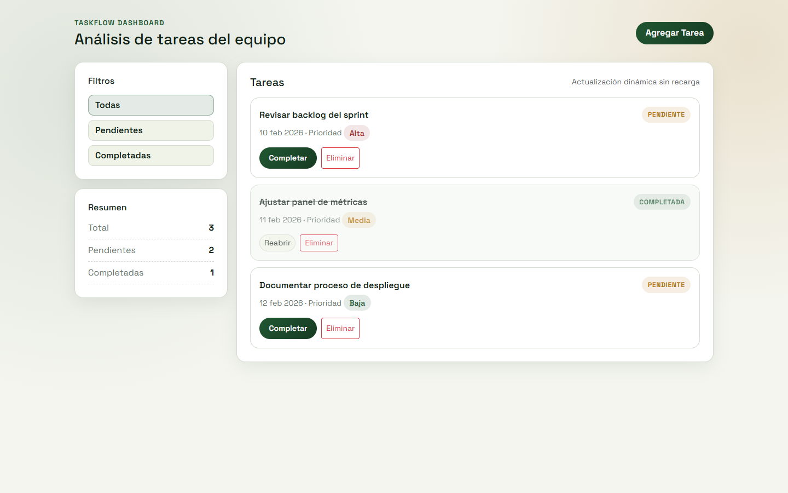
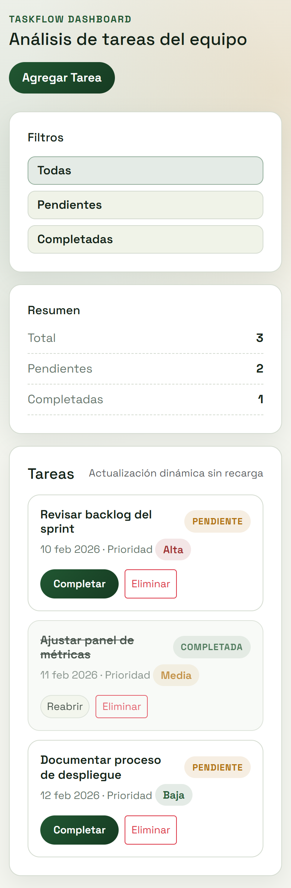

# TaskFlow Dashboard

Dashboard estatico para gestion de tareas de equipo usando HTML5 semantico, CSS Grid, Bootstrap personalizado, SASS modular y JavaScript ES6.

## Como ejecutar el proyecto
1. Instala dependencias:
```bash
npm install
```
2. Compila SASS:
```bash
npm run sass:build
```
3. Ejecuta la app:
- Opcion simple: abrir `index.html` en el navegador.
- Opcion recomendada: servir la carpeta con un servidor local (por ejemplo `npx serve .`) para emular un flujo real de desarrollo.

## Stack
- HTML5 + CSS Grid
- Bootstrap 5 (CDN)
- SASS (parciales)
- JavaScript ES6 (sin backend)
- Ruby (bonus para generar datos iniciales)

## Proceso de pensamiento y decisiones tecnicas
### Por que esta estructura de SASS
Use parciales para separar responsabilidades y mantener escalabilidad:
- `assets/scss/_variables.scss`: tokens de diseno (colores, spacing, breakpoints, sombras).
- `assets/scss/_mixins.scss`: reutilizacion de patrones (`focus-ring`, media queries).
- `assets/scss/_base.scss`: estilos globales y base visual.
- `assets/scss/_layout.scss`: distribucion estructural del dashboard.
- `assets/scss/_components.scss`: estilos de botones, tarjetas, filtros, estados de tarea y modal.
- `assets/scss/main.scss`: punto de entrada de compilacion.

Esto permite cambiar tema, layout o componentes sin mezclar estilos globales con estilos locales.

### Como resolvi el layout con Grid
El layout principal esta en `assets/scss/_layout.scss` con:
- `header` superior para branding y accion primaria.
- `dashboard-grid` con dos columnas en desktop:
  - sidebar fijo para filtros y resumen.
  - contenido flexible para lista de tareas.
- en pantallas pequenas, el grid pasa a una sola columna para mantener legibilidad y usabilidad movil.

## Funcionalidades implementadas
- Crear tareas desde modal sin recargar la pagina.
- Filtrar tareas por `Todas`, `Pendientes`, `Completadas`.
- Marcar tarea como `Completada` o `Pendiente`.
- Eliminar tareas.
- Resumen dinamico (total, pendientes, completadas).
- Bug responsive intencional corregido en la version final.

## Capturas de pantalla
### Escritorio


### Movil


## Bonus Ruby
Archivo incluido: `scripts/generate_tasks.rb`

Generar tareas de ejemplo:
```bash
ruby scripts/generate_tasks.rb --count 8 --out data/tasks.seed.json
```

Tambien puedes redirigir salida estandar:
```bash
ruby scripts/generate_tasks.rb > data/tasks.seed.json
```

## Desarrollo, privacidad y comprobaciones

La versión actual usa tareas de ejemplo y estado en memoria. No hay backend ni colaboración entre usuarios.

Los datos del navegador no se suben automáticamente a GitHub. Pueden perderse al borrar el almacenamiento o cambiar de navegador, perfil o dirección. localStorage e IndexedDB no son una bóveda cifrada ni un sistema de cuentas; no ofrecen aislamiento entre aplicaciones del mismo origen. Usá datos ficticios al preparar demos y pruebas. Conservá tus respaldos reales fuera de la carpeta del repositorio o dentro de `private-data/`, `backups/` o `exports/`, que están excluidas de Git. Las capturas privadas van en `private-screenshots/`; las capturas públicas deben revisarse manualmente.

`.gitignore` evita agregados accidentales, pero no elimina archivos ya versionados y se puede omitir con `git add -f`. El control local/CI también rechaza rutas privadas, formatos de respaldo y JSON no previstos. Solo se permiten los JSON de configuración, ejemplos explícitos (`*.example.json`) y fixtures ficticios revisados (`tests/fixtures/*.example.json` o `*.example.csv`). No conviertas datos reales en ejemplos cambiándoles el nombre. Si necesitás otro archivo público legítimo, revisá su contenido y ajustá la lista permitida en `scripts/check-repository.cjs`. El detector usa patrones conocidos: no garantiza detectar todos los secretos ni datos personales en texto o imágenes.

### Comprobar antes de subir

Con **Node.js 24** y **Git**, desde la raíz del repositorio, sin instalar dependencias:

```sh
node scripts/check-repository.cjs --self-test
node scripts/check-repository.cjs
```

El chequeo básico valida archivos privados, patrones de credenciales, reglas de exclusión, JSON y sintaxis JavaScript, incluidos los scripts dentro de HTML. No abre la interfaz ni demuestra que todas las funciones de la aplicación sean correctas. Las pruebas adicionales usan datos sintéticos y almacenamiento aislado.

### Activar la protección local

Cada clon nuevo debe habilitar el hook explícitamente:

```sh
git config --local core.hooksPath .githooks
```

El hook ejecuta el control antes de crear un commit. Necesita Node.js en PATH; no accede al navegador ni envía datos por red. Podés correr el mismo control manualmente. Antes de cada subida revisá además `git diff --cached` y `git status`. Un detector de CI se ejecuta después de subir: complementa la prevención local, pero no evita una primera exposición. Si se filtra una credencial, revocala/rotala; borrar el archivo o hacer privado el repositorio no invalida las copias previas.

GitHub Actions ejecuta estos controles en cada push y pull request, con permisos de lectura y sin secretos. Las acciones se fijan a commits concretos. No se instala ninguna dependencia de la aplicación durante estas verificaciones.
